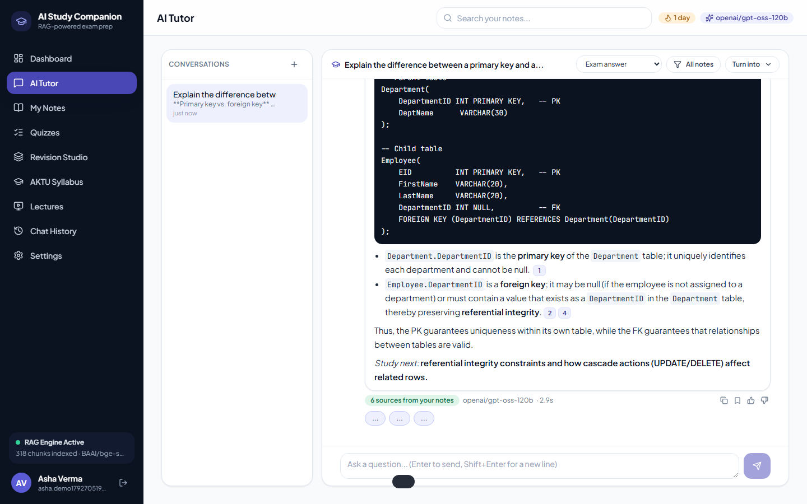
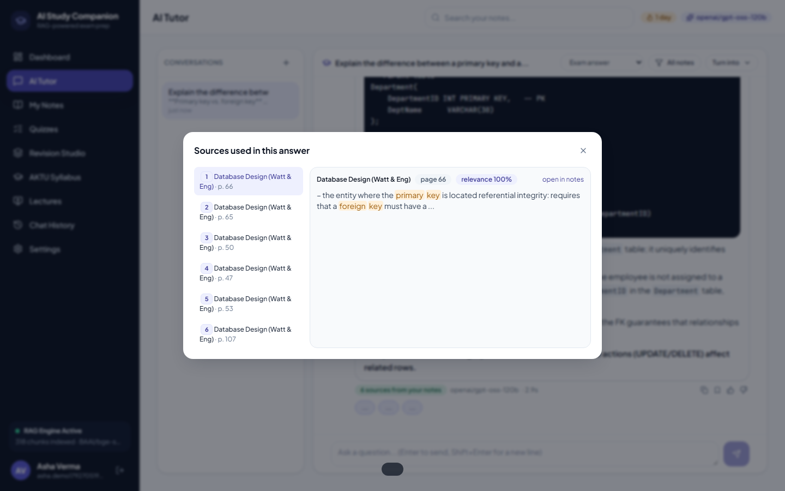
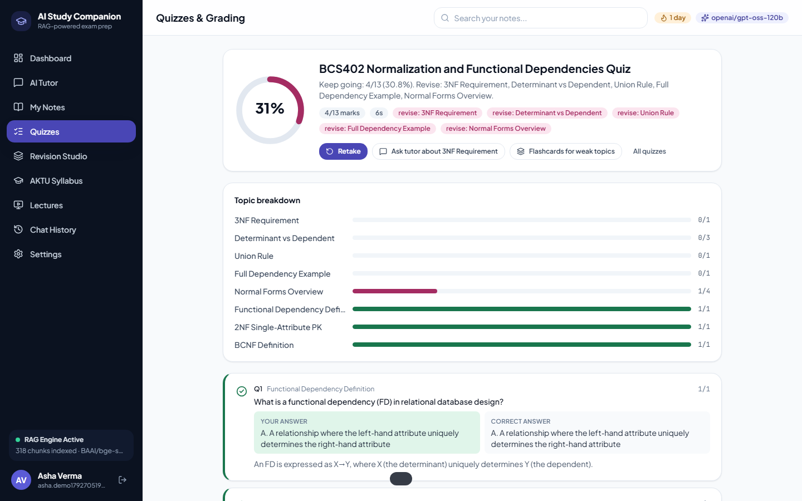
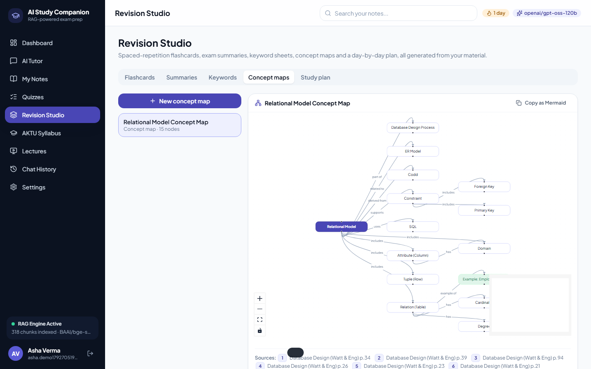
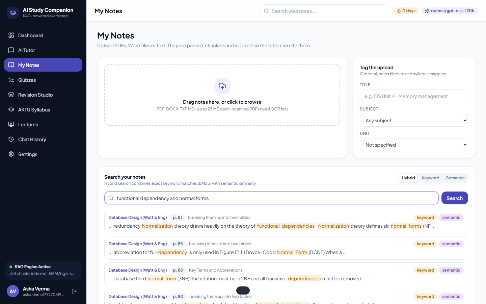
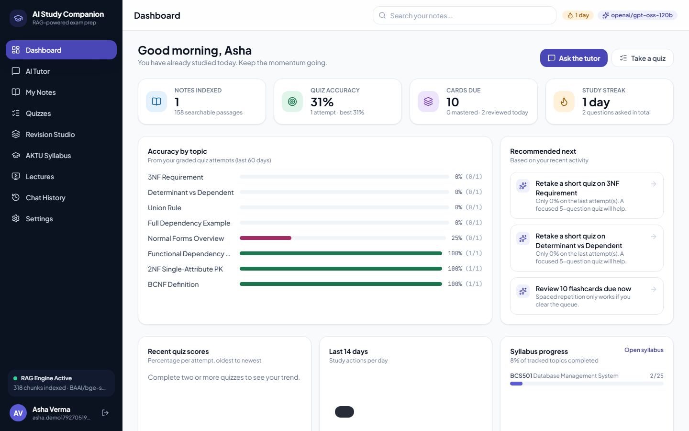

<p align="center">
  
</p>

<h1 align="center">AI Study Companion</h1>

<p align="center">
  A RAG-powered personal study assistant: grounded tutoring from <em>your</em> notes, quizzes with automated grading,
  spaced-repetition flashcards, concept maps and AKTU syllabus tracking. Bring your own model.
</p>

<p align="center">
  <a href="https://github.com/sachincse/ai-study-companion/actions/workflows/ci.yml"></a>
  
  
  
</p>

<p align="center">
  
  <br />
  <sub>Full walkthrough video: <a href="docs/demo/demo.mp4">docs/demo/demo.mp4</a></sub>
</p>

## Screens

| Cited tutor answer | Sources behind an answer | Graded quiz with topic breakdown |
|---|---|---|
|  |  |  |

| Concept map from the notes | Hybrid notes search | Dashboard |
|---|---|---|
|  |  |  |

All screenshots come from the demo run on the open-licensed *Database Design* textbook, not from mock data.

## Why

University exam prep is scattered across PDFs, handwritten notes and YouTube, and generic chatbots answer confidently
from the wrong syllabus. AI Study Companion keeps everything inside one workspace and makes every answer traceable to a
page in the student's own material.

| | NotebookLM | ChatPDF-style tools | Quizlet AI | **AI Study Companion** |
|---|---|---|---|---|
| Answers cite your uploaded notes | yes | yes | no | **yes, with page numbers and hybrid (BM25 + vector) retrieval** |
| Quizzes graded against the notes | basic | no | flashcard tests | **MCQ / true-false / rubric-graded short answers, per-topic accuracy** |
| Spaced repetition | no | no | yes | **SM-2 scheduling** |
| University syllabus built in | no | no | no | **AKTU B.Tech CSE units and topics** |
| Choice of model | fixed | fixed | fixed | **15 providers incl. free tiers and local Ollama** |
| Self-hosted, open source | no | no | no | **yes, single container** |

## Features

- **AI tutor with citations.** Hybrid retrieval over your notes (SQLite FTS5 BM25 fused with vector similarity), streamed answers with `[n]` citations that open the source passage, six answer styles (exam, beginner, detailed, short, step-by-step, practice questions), follow-up suggestions, bookmarks and feedback.
- **Notes library.** Upload PDF, DOCX, TXT or Markdown; files are parsed, chunked (~500 tokens with page tracking), embedded locally and indexed. Keyword, semantic or hybrid search with highlighted snippets; open the original passage by page.
- **Quizzes and grading.** Generate quizzes from a topic, a syllabus unit or specific documents; timed or untimed; objective questions auto-graded, descriptive answers graded against a rubric with feedback; topic breakdown and weak-topic detection on every attempt.
- **Revision Studio.** Flashcard decks with SM-2 spaced repetition (keyboard driven), exam summaries, keyword sheets, interactive concept maps and flowcharts (React Flow, exportable as Mermaid) and a day-by-day study plan built from the syllabus and your weak topics.
- **AKTU syllabus.** Nine core CSE subjects (3rd to 5th semester) with unit-wise topics; tick topics as covered and jump straight to a quiz, flashcards or lectures for any unit. Add a subject with one YAML file.
- **Lecture finder.** YouTube search per subject and topic (official Data API if you have a key, otherwise a keyless fallback) plus curated channels AKTU students rely on.
- **Dashboard.** Accuracy by topic, score trend, 14-day activity, streak, cards due, syllabus coverage and rule-based recommendations for what to do next.
- **Searchable history.** Every conversation is full-text indexed; bookmark the explanations worth keeping.
- **Bring your own model.** Groq, Google Gemini, OpenAI, Anthropic Claude, xAI Grok, OpenRouter, Mistral, DeepSeek, Together, Cerebras, SambaNova, GitHub Models, Hugging Face, NVIDIA NIM, a local Ollama or any OpenAI-compatible endpoint. Several of those have free tiers (see [`docs/PROVIDERS.md`](docs/PROVIDERS.md)). Keys live in `.env` or are pasted per account (encrypted at rest). The Settings page lists each provider's live model catalogue and has a one-click connection test.

## Quick start

**Prerequisites:** Python 3.11+, Node 22+, and one of: an API key from a provider above (Groq and Gemini have free tiers) or [Ollama](https://ollama.com) running locally.

```bash
git clone https://github.com/sachincse/ai-study-companion.git
cd ai-study-companion
cp .env.example .env             # put your key in, e.g. GROQ_API_KEY=gsk_...

# Windows
.\scripts\dev.ps1
# macOS / Linux
./scripts/dev.sh
```

Open http://localhost:5173, create an account, upload notes, ask a question. API docs live at http://localhost:8000/api/docs.

<details>
<summary>Manual setup</summary>

```bash
cd backend
python -m venv .venv && . .venv/bin/activate      # Windows: .venv\Scripts\activate
pip install -r requirements.txt
uvicorn app.main:app --reload --port 8000

cd ../frontend
npm install
npm run dev
```
</details>

<details>
<summary>Docker (single container, serves the built UI on port 8000)</summary>

```bash
cp .env.example .env
# production mode needs a real secret: python -c "import secrets; print(secrets.token_urlsafe(48))" -> SECRET_KEY=...
# add one provider key, then:
docker compose up --build

# optional fully-offline inference (set LLM_PROVIDER=ollama and OLLAMA_BASE_URL=http://ollama:11434 in .env first):
docker compose --profile local up -d ollama && docker compose exec ollama ollama pull qwen2.5:7b
```
</details>

On first start the server downloads the local embedding model (`BAAI/bge-small-en-v1.5`, ~130 MB) in the background; the sidebar shows "RAG Engine warming up" until it is ready. No notes ever leave your machine for indexing; only the question plus the retrieved passages are sent to the chat model you chose.

### Try it on real textbooks

```bash
python scripts/fetch_open_notes.py
```

downloads four complete, Creative Commons textbooks (Open Data Structures, Database Design 2nd ed., Operating Systems and Middleware, Discrete Mathematics: An Open Introduction) into `data/sample_notes/`. Upload any of them from the Notes page. Licences and attribution: [`data/sample_notes/SOURCES.md`](data/sample_notes/SOURCES.md).

## Benchmark

Measured on those four books (not on synthetic text) with the exact service code the API uses. Retrieval asks whether the passage a question was written from comes back; answer quality uses a second model as judge. Details and how to reproduce: [`docs/BENCHMARK.md`](docs/BENCHMARK.md), latest full numbers: [`benchmarks/RESULTS.md`](benchmarks/RESULTS.md).

<!-- BENCHMARK:START -->
_Results are filled in from `benchmarks/RESULTS.md` after a run._
<!-- BENCHMARK:END -->

## How it works

```
upload ──> parse (pypdf / docx) ──> chunk (~500 tok, page-aware) ──> embed (fastembed) ──> Chroma + SQLite FTS5
question ──> BM25 ∪ vector search ──> reciprocal-rank fusion ──> numbered sources ──> LLM (streamed, cited) ──> saved + indexed
```

- **Backend:** FastAPI, SQLAlchemy, SQLite with FTS5, ChromaDB, fastembed, one OpenAI-compatible client for fourteen providers plus the official Anthropic SDK. Server-Sent Events for streaming.
- **Frontend:** React 19, TypeScript, Vite, Tailwind, TanStack Query, React Flow, Recharts, KaTeX.
- **Grading:** deterministic for MCQ/true-false; rubric-based LLM grading for short answers with a keyword-coverage fallback if the model is unavailable.
- **Scheduling:** SM-2 with ease factor floor 1.3; lapses relearn after 10 minutes.

Full write-up with diagrams: [`docs/ARCHITECTURE.md`](docs/ARCHITECTURE.md). Provider setup: [`docs/PROVIDERS.md`](docs/PROVIDERS.md).

## API overview

All endpoints are under `/api/v1` and documented at `/api/docs` (OpenAPI). Highlights:

| Area | Endpoints |
|---|---|
| Auth | `POST /auth/register`, `POST /auth/login`, `GET/PATCH /auth/me` |
| Notes | `POST /documents` (multipart), `GET /documents`, `GET /documents/{id}/chunks`, `POST /documents/{id}/reindex`, `DELETE /documents/{id}`, `GET /search?q=&mode=hybrid\|keyword\|semantic` |
| Tutor | `POST /chat/sessions`, `POST /chat/sessions/{id}/messages` (SSE stream), `.../messages/sync`, `POST /chat/messages/{id}/bookmark`, `GET /search/history?q=` |
| Quizzes | `POST /quizzes/generate`, `POST /quizzes/{id}/attempts`, `POST /quizzes/attempts/{id}/submit`, `GET /quizzes/attempts` |
| Flashcards | `POST /flashcards/generate`, `GET /flashcards/due`, `POST /flashcards/cards/{id}/review` (`again\|hard\|good\|easy`) |
| Tools | `POST /tools/summary`, `/tools/keywords`, `/tools/concept-map`, `/tools/study-plan`, `GET /tools/artifacts?kind=` |
| Syllabus | `GET /syllabus/subjects`, `GET /syllabus/subjects/{id}`, `POST /syllabus/topics/{id}/progress` |
| Other | `GET /dashboard`, `GET /resources/videos`, `GET /settings/providers`, `PUT /settings/llm`, `POST /settings/llm/test`, `POST /settings/llm/models`, `GET /system/health` |

## Project structure

```
ai-study-companion/
├── backend/
│   ├── app/
│   │   ├── api/v1/        routers (auth, documents, chat, quizzes, flashcards, tools, misc)
│   │   ├── core/          config, database (SQLite + FTS5), security, dependencies
│   │   ├── models/        SQLAlchemy tables
│   │   ├── schemas/       Pydantic request/response models
│   │   ├── services/      chunking, parsing, embeddings, vector store, search, rag, chat,
│   │   │                  quiz/grading, flashcards + sm2, learning tools, videos, dashboard, syllabus
│   │   └── services/llm/  provider registry, OpenAI-compatible client, Anthropic client
│   └── tests/             offline test-suite (fake LLM, hash embeddings, in-memory vectors)
├── frontend/src/
│   ├── pages/             Dashboard, Tutor, Notes, Quizzes, Attempt, Result, Revision, Syllabus, Subject, Lectures, History, Settings, Auth
│   ├── components/        app shell, markdown with citation chips, pickers, revision studio tabs
│   └── lib/               API client + SSE reader, auth context, hooks, types
├── data/syllabus/         AKTU subjects as YAML (BCS301-303, 401-403, 501-503)
├── data/videos/           curated lecture channels
├── benchmarks/            eval-set builder, benchmark runner, results
├── scripts/               dev launchers, open-textbook fetcher, demo recorder
└── docs/                  architecture, providers, benchmark, demo video + screenshots
```

## Tests and quality

```bash
cd backend && ruff check app tests && pytest -q      # offline: no keys, no downloads
cd frontend && npm run lint && npm run build
```

The backend suite covers chunking, SM-2 scheduling, JSON extraction and reasoning-tag filtering, FTS5/hybrid search scoping, and the full API flow (auth, upload/index, search, streaming chat, quiz generation/grading, flashcards, learning tools, syllabus progress, dashboard, settings) including cross-account privacy checks. CI runs both suites and builds the Docker image.

## Roadmap

- OCR for scanned PDFs (Tesseract) and image-based notes
- Shared, teacher-curated question banks and class dashboards
- Re-ranking (cross-encoder) and multilingual embeddings for Hindi/English notes
- Export revision sheets and quizzes as PDF
- Mobile layout polish and offline-first PWA

## Acknowledgements

Built from a mini-project proposal by the Department of Computer Science and Data Science, GL Bajaj Institute of Technology and Management ("AI Study Companion: a RAG-powered personal assistant for automated notes search, quiz evaluation and AKTU syllabus learning"). Retrieval-augmented generation follows Lewis et al. (2020). Sample material comes from the open textbooks credited in `data/sample_notes/SOURCES.md`.

## License

MIT. See [LICENSE](LICENSE). The textbooks fetched by `scripts/fetch_open_notes.py` keep their own Creative Commons licences.
